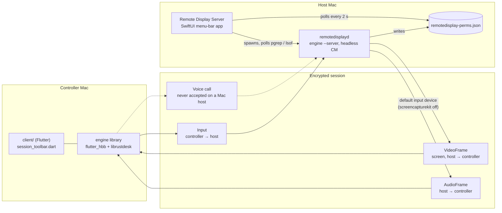
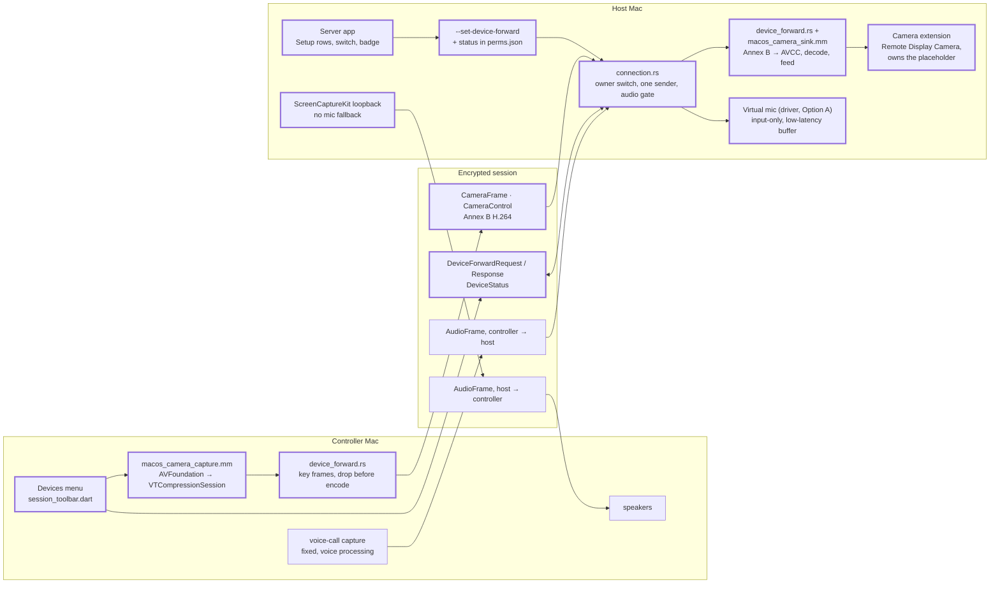

# Architecture: camera & audio forwarding

Where the architecture started, where the [spec](../specs/camera-audio-forwarding.md)
takes it, and where it is now. Read this before changing the design; update it in the
same PR as the change.

- **Decisions** live in [`decisions/`](decisions/README.md), one short record each.
  Records are numbered, never renumbered or deleted; a replaced decision is marked
  *Superseded by* and stays.
- **Every PR that changes the design** adds or updates a record, the
  [current state](#current-state) table and the [change log](#change-log).
- **Every departure** from the original spec (at `4df72ed`) or from a repo convention
  below needs a record that says so and why, and a row in
  [departures](#departures-from-the-original-spec).

## Guardrails: patterns we follow

New code follows what the repo already does. Inventing a new pattern needs a decision
record first.

| Area | Existing pattern | Source |
|---|---|---|
| Engine changes | The engine is vendored RustDesk 1.4.9. Keep changes minimal, put new code in new files so `engine/update.sh` re-applies cleanly, mark hooks with a `remotedisplay:` comment, and list them in `HOOKS.md` and the "What is ours" table in `engine/SYNC.md`. | CONTRIBUTING.md, HOOKS.md, engine/SYNC.md |
| macOS platform code in the engine | Objective-C++ `.mm` files exposing `extern "C"` functions named `Mac…`, compiled by `build.rs` with `cc`, called from Rust `extern "C"` blocks. | `src/platform/macos.mm`, `src/platform/macos.rs` |
| Server app ↔ engine, commands | A user-level CLI flag on `remotedisplayd` that skips the install/root gate and talks IPC to the running `--server` as the same user. | `--set-lan-password` in `src/core_main.rs` |
| Server app ↔ engine, status | The engine writes `~/Library/Application Support/remotedisplay-perms.json`; the app polls it, `pgrep` and `lsof` every 2 s and doesn't change observed state while its menu is open. | `ServerController.swift` |
| Server app | Swift/SwiftUI on SwiftPM, bundled and signed by `server-mac/Makefile` with a stable identity and an explicit designated requirement. | `server-mac/` |
| Client UI | `client/` owns its toolbar and consumes the engine's Flutter code as a package, with hooks only where listed in HOOKS.md. | `client/lib/session/session_toolbar.dart` |
| macOS behaviour | Measured, not assumed: a `docs/tests/<topic>/` folder with a README (what was tested and the result, runtime findings, how to re-run) and a `harness/`. | CONTRIBUTING.md, `docs/tests/vdisplay-vm/` |
| Protocol | Additive protobuf changes only, so older peers ignore what they don't know. | spec, Protocol changes |
| Commits | Short imperative summary; the body explains why. | CONTRIBUTING.md |

## Baseline: Remote Display 1.0.x

The code at `86f1b23`, before any of this work.

- There is no camera path in either direction on macOS.
- Host sound is really the host's microphone, because the release build leaves
  `screencapturekit` off.
- The host plays any controller's incoming audio while that controller's
  `disable_audio` is off, whether or not anyone accepted a call.

## Target: v1

Phases 0–3 of the spec as revised after the review in PR #16. Thick borders are new.

## Current state

What exists today, by component. *Planned* means only the spec describes it; *harness*
means a Phase 0 measurement exists; *built* means merged into the feature branch;
*shipped* means released.

| Component | Phase | Status | Where |
|---|---|---|---|
| Spec | — | Revised after review | `docs/specs/camera-audio-forwarding.md` |
| Camera extension | 0 → 1 | Harness built; gate tests need a signed build | `docs/tests/camera-extension/harness/CameraExtension/` → `server-mac/CameraExtension/` |
| Camera extension container (activate, remove) | 0 → 1 | Harness built; activation refused unsigned, as expected | `docs/tests/camera-extension/harness/ContainerApp/` → server app Setup row |
| Camera sink feeder | 0 → 1 | Harness built; enumerates CoreMediaIO devices | `docs/tests/camera-extension/harness/camera_sink.mm` → `src/platform/macos_camera_sink.mm` |
| Virtual mic, Option A (driver), **chosen** | 0 → 2 | Harness tested: installs, carries the signal bit-exact, input-only, uninstalls cleanly; Zoom/Teams and reboot still to check | `docs/tests/virtual-mic/harness/` (driver target) → `server-mac/AudioDriver/` |
| Virtual mic, Option B (tap), fallback | 0 | Harness tested: works with `CATapMuted`, no prompts; device lives only with its process | `docs/tests/virtual-mic/harness/mic_sink.mm` |
| Virtual-mic feeding | 0 → 2 | Harness tested for both options | `docs/tests/virtual-mic/harness/mic_sink.mm` → engine, behind the jitter buffer |
| Messages 200–204 | 1 | Built and tested (wire numbers, round trip, older peers ignore them); nothing sends or handles them yet | `libs/hbb_common/protos/message.proto`, tests in `tests/device_forward_messages.rs` |
| Controller capture and encode | 1 | Built and tested with a USB camera: 720p30 H.264 from the low-latency hardware encoder; every unit decodes with the host's decoder | `src/platform/macos_camera_capture.mm` + `.rs`; tests in `docs/tests/camera-capture/` |
| Host decode (Annex B → frames) | 1 | Tested in the harness, incl. sanitizer fuzz | `docs/tests/camera-extension/harness/camera_codec.mm` → in front of `src/platform/macos_camera_sink.mm` |
| Camera sender and channel | 1 | Built: unit-tested with a fake camera; with the real camera, CameraFrames at 30 fps only between the host's accept and stop (`docs/tests/camera-capture/`); nothing turns it on until the Devices menu | `src/client/device_forward.rs`, `io_loop.rs` and `client.rs` hooks |
| Host request handling | 1–2 | Built for the camera (unit-tested): capabilities, answers, one sender, frames to the sink, `DeviceStatus`, the owner's switch ends forwards; the camera is `not-installed` until the sink feeder, the mic until Phase 2 | `src/server/connection.rs`, `src/server/device_forward.rs` |
| Host audio gate | 2 | Built for voice calls (unit-tested); the mic forward joins it in Phase 2 | `src/server/connection.rs` + `connection/audio_gate.rs` |
| Owner's switch and status | 1 | Switch built (CLI, perms field, Settings toggle) and it ends live forwards; the forwarding-status file waits for the Setup row and badge | `--set-device-forward` in `src/core_main.rs` + `src/server/device_forward.rs`, `remotedisplay-perms.json`, server app Settings |
| Devices menu | 1 | Planned | `client/lib/session/session_toolbar.dart` |
| System sound | 3 | Engine guard and release flag done; gate tests pass (the frames carry the tone, nothing is sent without Screen Recording); the switch waits for the Devices menu | `release/release-mac.sh`, `src/server/audio_service.rs` + `audio_service/host_sound.rs`; tests in `docs/tests/system-sound/` |

## Departures from the original spec

Changes against the spec as first written (`4df72ed`). Each has a record.

| The original spec said | Now | Why | Record |
|---|---|---|---|
| Hand camera buffers to the VideoToolbox encoder that hwcodec wraps | Encode with `VTCompressionSession` in a new `.mm` | hwcodec takes one CPU buffer and can't force key frames or change bitrate live | [0004](decisions/0004-camera-encode-videotoolbox.md) |
| `CameraFrame` reuses `EncodedVideoFrames` (format unstated) | H.264 Annex B with SPS/PPS on key frames | VideoToolbox needs AVCC; Annex B matches hwcodec for Phase 4 | [0005](decisions/0005-annex-b-wire-format.md) |
| Drop frames once 150 ms is queued | Drop before encoding; own bounded channel | Encoded P-frames can't be dropped; the session sender is shared with input | [0006](decisions/0006-camera-channel-drop-before-encode.md) |
| Mic reuses the voice-call path | Reuse it with fixes, gate incoming audio on an accepted forward, separate low-latency buffer | The host plays unrequested audio today; the voice-call code spins and buffers 600 ms+ | [0007](decisions/0007-host-audio-gate.md), [0008](decisions/0008-mic-path.md) |
| Report state to the app "over the existing IPC" | User-level `--set-device-forward` plus status in `remotedisplay-perms.json` | No such IPC exists; this reuses the two patterns that do | [0009](decisions/0009-owner-switch-cli-and-status-file.md) |
| Add the install entitlement to the app's entitlements | One entitlements file per binary; extension signed first | The Makefile signs every binary with one file | [0010](decisions/0010-entitlements-per-binary.md) |
| The extension shows the card while the sink is idle | The extension owns the placeholder on a 500 ms timer, always drains the sink, shares no storage | A crashed feeder would leave a frozen frame; the extension runs as another user | [0011](decisions/0011-extension-owns-placeholder.md) |
| Show each switch only when its capability flag is present | Devices menu always shown; status strings; `DeviceStatus` (204) | Flags are sent once and can't say why | [0012](decisions/0012-devices-menu-and-device-status.md) |
| Turn on `screencapturekit` | Turn it on and remove its fallback to the host's mic | The feature still falls back to the default input device | [0008](decisions/0008-mic-path.md) |
| Build the extension with `xcodebuild` from its own target | Phase 0: `swiftc` and a Makefile, like `server-mac/Makefile`; Phase 1 decides | No Xcode project to maintain; matches how the server app is already built | [0014](decisions/0014-phase0-camera-harness.md) |
| Reserve `Message.union` 100–119, pending upstream's maintainer | 200–219, decided in this fork; forwarding takes 200–204 | The fork owns its protocol; 100 is the obvious block for anyone else's additions, upstream Remote Display's included | [0017](decisions/0017-reserved-message-range-200.md) |
| Option A: a driver "adapted from BlackHole" | BlackHole configured by its build constants, unmodified; fetched at a pinned commit for Phase 0 | Its constants already give the input-only layout; Phase 2 decides between vendoring and a pinned fetch | [0015](decisions/0015-virtual-mic-harness.md) |

## Change log

| Date | Change | Records |
|---|---|---|
| 2026-10-23 | Spec added (`4df72ed`) | [0001](decisions/0001-spec-first-gated-phases.md)–[0003](decisions/0003-cameraframe-message.md) |
| 2026-10-24 | Spec revised after the review in PR #16 (`6731a75`…`8d0fc62`); this folder added | [0004](decisions/0004-camera-encode-videotoolbox.md)–[0013](decisions/0013-virtual-mic-input-only-driver.md) |
| 2026-10-24 | Phase 0 camera harness in `docs/tests/camera-extension/` (issue #1): builds; gate tests wait for a signed build | [0014](decisions/0014-phase0-camera-harness.md) |
| 2026-10-24 | Phase 0 virtual-mic harness in `docs/tests/virtual-mic/` (issue #1) | [0015](decisions/0015-virtual-mic-harness.md) |
| 2026-10-24 | Mic gate tests run: both options carry the signal; Option A chosen; the coreaudiod restart is `killall`, since `launchctl kickstart` is refused under SIP | [0013](decisions/0013-virtual-mic-input-only-driver.md) accepted |
| 2026-10-24 | Camera codec path measured in `docs/tests/camera-extension/` (issue #2): encode, Annex B, decode, limits and fuzz all pass; low-latency hardware encoder chosen | [0016](decisions/0016-camera-encoder-and-decoder-contract.md); notes in [0004](decisions/0004-camera-encode-videotoolbox.md), [0005](decisions/0005-annex-b-wire-format.md) |
| 2026-10-26 | Phase 3 engine side (issue #4): host sound never falls back to an input device; `screencapturekit` on for the server binary only, which needs full Xcode to build; gate tests in `docs/tests/system-sound/` pass | [0008](decisions/0008-mic-path.md) Phase 3 results |
| 2026-10-26 | Host audio gate (issue #3): a controller's audio plays on the host only during an accepted call, independent of `disable_audio`; a Remote Display host drops it all until the mic forward exists | [0007](decisions/0007-host-audio-gate.md) implementation |
| 2026-10-26 | Owner's switch (issue #2): `--set-device-forward on\|off`, `device_forward` in the perms file, the Settings toggle; the perms file stays booleans-only, so forwarding status will need its own file | [0009](decisions/0009-owner-switch-cli-and-status-file.md) implementation |
| 2026-10-27 | Message range decided in the fork: Remote Display reserves `Message.union` 200–219, not 100–119 (issue #14 closed); the five forwarding messages added at 200–204 with tests (issue #2) | [0017](decisions/0017-reserved-message-range-200.md) supersedes [0002](decisions/0002-reserved-message-range.md) |
| 2026-10-27 | Controller camera capture and encode (issue #2): AVFoundation → the measured VideoToolbox encoder → Annex B; key frames on request, live bitrate, frames dropped only before encoding; Remote Display Camera never listed; the client gains the camera keys, including Continuity Camera's | [0004](decisions/0004-camera-encode-videotoolbox.md) implementation |
| 2026-10-27 | Controller camera sender (issue #2): request, frames only once accepted, `CameraControl`, stop on switch-off, refusal, 10 s without an answer or session end; a 3-frame queue served after queued input instead of a biased `select!` | [0006](decisions/0006-camera-channel-drop-before-encode.md) implementation |
| 2026-10-27 | Host request handling (issue #2): capabilities in the login response, answers with the owner's switch, sink status and format limits (`bad-format`), one sender per device, the accepted controller's frames to the sink, `DeviceStatus` on change, forwards end when the switch goes off | [0012](decisions/0012-devices-menu-and-device-status.md) host side, [0009](decisions/0009-owner-switch-cli-and-status-file.md) |
