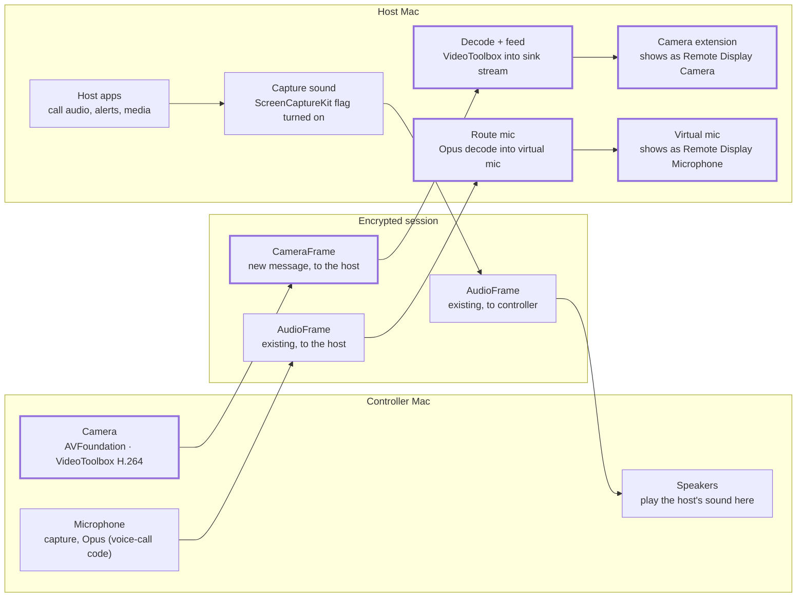

# Remote Display: Camera & Audio Forwarding Spec

*Paolo Aquino · 2026-10-22 · [living copy](https://claude.ai/artifact/DWPz1w2gd7d6JxHsrrBZGN)*

## Summary

Add camera, microphone and speaker forwarding to [Remote Display](https://github.com/SamuelRioTz/remotedisplay), so someone controlling a Mac host can take a video call on that Mac with their own camera, mic and speakers. The controller's camera appears on the host as an ordinary webcam and their mic as an ordinary input device, so Zoom, Teams, FaceTime or a browser call can use them with no plugins. Camera comes first, because it is the piece no consumer remote desktop offers for a Mac host today; mic and speakers follow.

## Background

Outside Citrix's enterprise virtual desktops, no remote desktop we found forwards a controller's camera into a Mac host; Jump Desktop and Splashtop forward only the mic. The table shows what each tool does when the host is a Mac, as of October 2026.

| Tool | Mic into a Mac host | Camera into a Mac host | Notes |
|---|---|---|---|
| [Jump Desktop](https://changelog.jumpdesktop.com/microphone-forwarding-for-fluid-4CTeHS) | Yes, as "Jump Desktop Microphone" | No | Mic is Mac-to-Mac only; webcam redirection is [requested, with no timeline](https://support.jumpdesktop.com/hc/en-us/community/posts/360077999432/comments/360015361411) |
| [Splashtop](https://support-splashtopbusiness.splashtop.com/hc/en-us/articles/48955447706267-Redirect-Camera-Input) | [Yes](https://support-splashtopbusiness.splashtop.com/hc/en-us/articles/360055835272) | No | Camera redirection needs Windows 10+ on both ends |
| [Parsec](https://support.parsec.app/hc/en-us/articles/32380350695956-Use-your-Microphone-with-Parsec) | No | No | Mic passthrough needs a Windows host |
| [Citrix VDA for macOS](https://docs.citrix.com/en-us/mac-vda/configure/general-content-redirection/webcam-redirection) | Yes | Yes | Enterprise virtual-desktop infrastructure; webcams arrive through a macOS camera extension |
| Remote Display 1.0.x | No | No | See the two gaps below |

Citrix shows the approach works on macOS: its host exposes redirected webcams through a camera extension. This spec brings the same idea to a free, self-hosted tool.

Remote Display is the right base for three reasons:

- It is built for Mac hosts: a notarized menu-bar server app (server-mac/) runs the RustDesk 1.4.9 engine as remotedisplayd.
- The engine already sends audio both ways for RustDesk's voice calls, and already encodes and decodes H.264 with VideoToolbox through hwcodec.
- It is AGPL-3.0, so improvements stay open.

Two gaps in today's code matter here:

- RustDesk's camera support (libs/scrap/src/common/camera.rs, behind "View camera") builds only on Windows and Linux; on macOS it returns "This platform doesn't support camera yet". It also points the other way, streaming the host's camera to the controller.
- The headless connection manager on the Mac host (headless_cm in src/core_main.rs) does nothing with an incoming voice call, so the request is never accepted and a controller's mic never reaches the host.

## Goals and non-goals

v1 is done when someone on a MacBook can join a Zoom call running on their Mac Studio, through Remote Display, with their own camera and mic, and hear the call.

Goals for v1:

- Camera: the controller's camera appears on the host as Remote Display Camera, selectable in FaceTime, Photo Booth, Zoom, Teams, Chrome, Safari and anything else that uses AVFoundation.
- Microphone: the controller's mic appears on the host as Remote Display Microphone, selectable as an input device.
- Speakers: the host's system sound plays on the controller. Today the Mac host falls back to its default input device instead (see Host side).
- Opt-in on both ends: the host owner allows forwarding once; the controller turns camera and mic on per session.
- No new ports or servers: media travels inside the existing encrypted Remote Display session.
- Backward compatible: older clients and hosts keep working; the new controls appear only when both sides support them.
- Platforms: macOS controllers; macOS 14+ hosts on Apple silicon, which is what Remote Display supports today.

Non-goals for v1:

- Windows, iPad and Android controllers (Phase 4; Windows can reuse RustDesk's existing camera capture).
- Windows or Linux hosts.
- More than one forwarded camera per host at a time.
- Exact lip sync; v1 measures the drift and aims for good enough for a call.
- Generic USB redirection.
- Changes to upstream RustDesk; upstreaming is a later conversation.

## User experience

The host owner sets it up once; the controller flips two switches per session.

On the host, once (Remote Display Server app):

- Setup gains two rows, Camera and Microphone, each with an Install… button, next to the existing Screen Recording and Accessibility rows.
- Install… for Camera activates the camera extension. An admin then allows it in System Settings: General › Login Items & Extensions › Camera Extensions on macOS 15 and later, Privacy & Security on macOS 14 (the same steps [Citrix documents](https://docs.citrix.com/en-us/mac-vda/configure/general-content-redirection/webcam-redirection) for its camera extension).
- Install… for Microphone installs the virtual mic with an admin prompt; the row disappears if the driverless option in Host side proves out.
- Settings gains Let controllers share their camera and microphone, off by default.

On the controller, per session:

- The session toolbar gains a Devices menu: ‹ · peer · full screen · fit · Input · Screen · Devices · ✕. It is always there, because Play the Mac's sound here works with every host, including 1.0.x.
- Devices holds on/off switches for Camera (with a picker when there is more than one), Microphone (with a picker), and Play the Mac's sound here. That last switch replaces the engine's Mute toggle, which today shows under Input › Session; Input stops showing it so there aren't two opposite switches for one setting.
- The first time, macOS asks the controller app for Camera access. If access was denied, the row says "Allow camera access in System Settings" and opens the right pane.
- When the host can't receive, the Camera or Microphone row is shown disabled and says why, for example "This Mac hasn't turned on camera sharing" or "Update Remote Display Server on this Mac". The row updates if the host owner changes the setting during the session.

On the host, while forwarding:

- The user picks Remote Display Camera and Remote Display Microphone in Zoom or any other app once; the devices exist even between sessions, so the choice sticks.
- With no controller sending, the camera shows a card ("Remote Display Camera — no controller connected") instead of freezing on the last frame.
- The menu-bar icon carries a camera or mic badge while a controller is sending, and the menu names that controller.
- On the controller, the Mac's own camera light shows when capture is on.

## Architecture overview

Each device rides the existing Remote Display session, and the host turns it back into an ordinary camera, microphone or sound source.



*Media paths · camera, mic, speakers. Thick borders are new in this spec.*

Highlighted boxes are new in this spec. Not drawn: the Remote Display Server app, which installs the camera extension and virtual mic, holds the owner's on/off switch, and shows the in-use badge.

| Piece | Where it lives | Change |
|---|---|---|
| Devices menu | client/lib/session/session_toolbar.dart | New menu |
| macOS camera capture and encode | src/platform/macos_camera_capture.mm | New file |
| Camera sender | src/client/device_forward.rs, src/client/io_loop.rs | New file, hook |
| Messages | libs/hbb_common/protos/message.proto (libs/base/protos/message.proto since RustDesk 1.5, [decision 0030](../architecture/decisions/0030-engine-rustdesk-1-5-1.md)) | New fields 200–204 |
| Request handling, mic routing | src/server/connection.rs, src/server/device_forward.rs | Changed, new file |
| Decode and sink feeder | src/platform/macos_camera_sink.mm | New file |
| Camera extension | server-mac/CameraExtension/ | New Xcode target |
| Virtual mic | server-mac/AudioDriver/ (Option A) or engine only (Option B) | New |
| Owner's switch, forwarding status | src/core_main.rs (--set-device-forward), remotedisplay-perms.json | Hook, changed |
| Setup rows, switch, badge | server-mac/Sources/RemoteDisplayServer/ | Changed |
| System sound | release/release-mac.sh | Turn on screencapturekit |

## Protocol changes

Five new messages carry the feature, and the mic reuses RustDesk's existing AudioFrame. Every change is additive, so peers that don't know the new messages ignore them.

Reserved numbers. Remote Display reserves Message.union numbers 200–219 for its own messages ([decision 0017](../architecture/decisions/0017-reserved-message-range-200.md)). RustDesk adds its messages at the end of the oneof (34 on its master in October 2026), so the block stays clear of upstream. This feature takes 200–204; later Remote Display features take the next free numbers in the block.

Proposed additions to libs/hbb_common/protos/message.proto:

```proto
// remotedisplay: device forwarding. Message.union numbers 200–219 are reserved
// for Remote Display, so upstream additions (33, 34, …) never collide.
message DeviceForwardRequest {          // controller → host
  enum Kind { CAMERA = 0; MICROPHONE = 1; }
  Kind kind = 1;
  bool on = 2;
  int32 width = 3;                      // camera only
  int32 height = 4;
  int32 fps = 5;
  string device_name = 6;               // shown in the host's menu
}
message DeviceForwardResponse {         // host → controller
  DeviceForwardRequest.Kind kind = 1;
  bool accepted = 2;
  string reason = 3;                    // "not-installed" | "not-approved" | "not-allowed" | "busy" | "bad-format"
}
message DeviceStatus {                  // host → controller, whenever it changes
  DeviceForwardRequest.Kind kind = 1;
  string status = 2;                    // "ready" | "not-installed" | "not-approved" | "not-allowed"
}
message CameraFrame {                   // controller → host
  VideoFrame frame = 1;                 // reuses EncodedVideoFrames; H.264 Annex B in v1
  int64 capture_time_us = 2;            // controller clock, for latency and sync
}
message CameraControl {                 // host → controller
  bool key_frame_request = 1;           // at most one per 500 ms
  int32 target_bitrate_kbps = 2;
}

message Message {
  oneof union {
    // … existing fields 3–32 …
    DeviceForwardRequest device_forward_request = 200;
    DeviceForwardResponse device_forward_response = 201;
    CameraFrame camera_frame = 202;
    CameraControl camera_control = 203;
    DeviceStatus device_status = 204;
  }
}
```

Capabilities. The host advertises what it can receive in PeerInfo.platform_additions, the one-level JSON map that src/server/connection.rs already fills. On a Mac host it carries supported_privacy_mode_impl today, plus the machine_id that Remote Display adds. Three new keys:

- rd_device_forward: protocol version, 1 for this spec.
- rd_camera_sink: a status string, "ready", "not-installed", "not-approved" (installed but not yet allowed in System Settings) or "not-allowed" (the owner's switch is off).
- rd_mic_sink: the same for the virtual mic.

platform_additions is sent once, with the login response, and never updates during a session. So the host also sends DeviceStatus whenever a status changes mid-session, for example when the owner flips the switch or finishes approving the extension. A host without rd_device_forward is 1.0.x: the controller shows the camera and mic rows disabled with "Update Remote Display Server on this Mac".

Flow.

- Turning the camera on sends DeviceForwardRequest{CAMERA, on: true} with the format the controller will send.
- The host answers DeviceForwardResponse. Frames flow only after accepted: true. With no answer within 10 seconds (a 1.0.x host ignores the request), the controller stops the camera and sends on: false.
- Frames stop on on: false, on disconnect, or when the owner switches the feature off; the host then sends accepted: false, reason: "not-allowed".
- A second controller asking for a busy device gets accepted: false, reason: "busy".

Microphone. After accepted, the controller sends ordinary Opus AudioFrames and a Misc.audio_format, the path RustDesk voice calls use. The host routes them to the virtual mic instead of its speakers. The voice-call accept step is skipped because the owner already allowed forwarding on the host.

The host accepts incoming controller audio only while a MICROPHONE forward (or a voice call) is active for that connection, and drops it otherwise, logging once. Today src/server/connection.rs plays any AudioFormat and AudioFrame a controller sends whenever that controller's disable_audio option is off. That is wrong in two ways: a controller that turns off Play the Mac's sound here would silence its own mic, and any connected controller can play sound through the host without anyone accepting it. With mic routing, the second becomes a way to put a voice into the host's calls, so this gate is a security fix, not a nicety.

Bitstream. CameraFrame carries H.264 in Annex B form (start codes), one access unit per EncodedVideoFrame, with SPS and PPS in front of every key frame (key: true). That is what hwcodec emits for the screen today, so a Windows controller (Phase 4) can send it unchanged; the macOS controller converts VideoToolbox's length-prefixed output before sending, and the host converts back before decoding (Host side).

Why a new CameraFrame instead of reusing VideoFrame? VideoFrame.display means a host display. Overloading it for controller-to-host video would confuse older peers and upstream code; a wrapper keeps the intent explicit and still reuses the codec payload.

Rate. Start at 1280×720, 30 fps, with the bitrate capped at 2 Mbit/s. The host lowers it with CameraControl when decoding falls behind, and asks for a key frame when it loses one, no more than once per 500 ms so a lossy link can't cause a storm. The controller drops frames before encoding when its send queue grows (Controller side).

## Controller side

The controller needs one new piece, a macOS camera capturer; mic capture, encoding and sending already exist in the engine.

Camera capture and encode on macOS (new). RustDesk's camera module uses nokhwa only on Windows and Linux, decodes every frame to RGBA, and carries a FIXME that macOS pixel buffers can't be built from those bytes. The screen encoder doesn't fit either: hwcodec's HwRamEncoder takes one contiguous CPU buffer in FFmpeg's layout, quartz::PixelBuffer is BGRA only, and convert_to_yuv rejects NV12 input, so a camera CVPixelBuffer would be copied twice. EncoderApi also has no way to force a key frame or change bitrate on a running encoder. Use AVFoundation and VideoToolbox directly instead, in a new src/platform/macos_camera_capture.mm that mirrors the host's macos_camera_sink.mm:

- An AVCaptureSession with AVCaptureVideoDataOutput delivering NV12 CVPixelBuffers, at 1280×720 and 30 fps when the camera offers it, with alwaysDiscardsLateVideoFrames on.
- Feed each buffer to a VTCompressionSession with VTCompressionSessionEncodeFrame: zero copy, H.264, low-latency rate control with the hardware encoder required, RealTime on, AllowFrameReordering off (no B-frames) ([decision 0016](../architecture/decisions/0016-camera-encoder-and-decoder-contract.md)).
- Force key frames per frame with kVTEncodeFrameOptionKey_ForceKeyFrame, and change bitrate live with AverageBitRate and DataRateLimits.
- Convert the length-prefixed output to Annex B, adding SPS and PPS from the format description in front of each key frame.
- hwcodec stays for Phase 4 (Windows), which already captures through nokhwa.
- Add NSCameraUsageDescription and NSCameraUseContinuityCameraDeviceType (without it AVFoundation leaves Continuity Camera out) to client/macos/Runner/Info.plist, and com.apple.security.device.camera to both entitlements files; the microphone equivalents are already there.

Microphone capture (exists, needs fixes). start_voice_call() in src/client/io_loop.rs already captures the default input through audio_service and sends Opus AudioFrames. Reuse it, started by DeviceForwardResponse instead of VoiceCallResponse, with three fixes, each listed in HOOKS.md:

- Its relay thread spins on try_recv() with no blocking receive or sleep, using a full CPU core for the whole call. Use a blocking receive with a timeout.
- It sets the input with set_voice_call_input_device(…, false), which keeps any device already set, so a later pick is ignored. Pass the chosen device with set_if_present = true and restart capture when it changes.
- The chosen device is a process-wide global, shared by every session. Scope it per session.

As built ([decision 0023](../architecture/decisions/0023-controller-microphone-capture.md)): the forward doesn't reuse start_voice_call(). That capture is one per process with a global device, so a per-session device would mean reworking upstream's audio service. Each forward opens its own capture of the chosen input instead (src/client/device_forward/mic.rs, cpal on its own thread), encoded as a voice call is: Opus, low delay, 10 ms frames, always 48 kHz mono. The voice call is unchanged. The capture fails at once without macOS's microphone access, which the Devices menu asks for first.

Echo. Without headphones, the far end's voice goes host → controller speakers → controller mic → host virtual mic → back into the call. The host app's echo canceller can't remove it: the speaker is on another machine and 100–300 ms away. Capture the controller mic with Apple's voice processing (AVAudioEngine's input node with voice processing on), which cancels echo against the controller's own speaker output. If Phase 2 shows that isn't enough, v1 asks for headphones, with a hint in the Devices menu when both Microphone and Play the Mac's sound here are on.

As built ([decision 0026](../architecture/decisions/0026-echo-headphones-not-voice-processing.md)): no voice processing. Measured on a Mac mini with a Bluetooth headset, a USB microphone and the built-in speakers, it didn't start in any of four ways of picking its devices, the system's defaults included, and turning it on blocked for minutes each time. It would also follow the system's defaults, not the menu's pick. So v1 asks for headphones, with the hint. If that isn't enough, a software echo canceller with the host's sound as its reference is the way.

Sending (new). A new src/client/device_forward.rs owns the camera thread: capture, encode, wrap in CameraFrame, hand to the session's sender. Its rules:

- Send a key frame at start, every 2 seconds, and whenever CameraControl.key_frame_request arrives.
- Drop frames before they are encoded, never after: a dropped P-frame smears the picture until the next key frame. Capture hands frames to the encoder through a slot that holds one frame, so a slow encoder skips frames instead of queuing them.
- Give camera frames their own bounded channel (2–4 frames) into the io loop, separate from the session's unbounded sender that carries input today, and poll it after input in a biased select!, so mouse and keyboard never wait behind video. Track the bytes and age of frames in flight; once more than 150 ms is waiting, skip capture frames until it drains. If an encoded frame still has to be dropped, force a key frame on the next encode. This is a hook in io_loop.rs, listed in HOOKS.md.
- Stop capture the moment the user switches off, the host refuses, or the session ends; the camera light goes off with it.

As built ([decision 0020](../architecture/decisions/0020-camera-lost-mid-forward.md)): capture also stops when the camera goes away, unplugged or stopped by a runtime error. The controller then sends on: false, so the host stops the sink at once, and the menu says the camera was disconnected or stopped working. The forward doesn't move to another camera, and doesn't restart when the camera is plugged back in.

UI (new). client/lib/session/session_toolbar.dart gets the Devices menu, and drops the engine's Mute toggle from Input › Session. New FFI calls in src/flutter_ffi.rs back it:

- session_set_device_forward(session_id, kind, on, device) and session_get_device_forward_state(session_id), which includes the host's latest status for each device.
- list_cameras() and list_microphones(), with an event when a device is plugged in or removed.
- get_capture_permission(kind) and request_capture_permission(kind), for the controller's own Camera and Microphone access.

Adding FFI calls means regenerating the flutter_rust_bridge bindings (the Dart side and client/macos/Runner/bridge_generated.h); the Phase 1 task list includes that step, and every engine touch goes in HOOKS.md and engine/SYNC.md.

As built ([decision 0018](../architecture/decisions/0018-devices-menu-state-and-ffi.md)): the forward's state, including the host's latest status, reaches the menu as an rd_device_forward session event on every change, the way the voice call reports its state, so there is no getter. The calls are session_set_device_forward, main_list_cameras, main_get_capture_permission and main_request_capture_permission. The camera list is read each time the menu opens; the hot-plug event comes with the microphone list in Phase 2.

As built for the microphone ([decision 0024](../architecture/decisions/0024-devices-menu-microphone-row.md)): main_list_microphones lists the controller's inputs by name, without Remote Display Microphone. Like the camera list it's read each time the menu opens, so there's no plug-in event. While the microphone is on and Play the Mac's sound here is on, the row shows the headphones hint, which is v1's answer to echo (decision 0026). The row is disabled during a voice call, which would send the microphone a second time.

Testing without a camera. A --camera-test-pattern option sends a moving test card with a running clock, so the VM test bench can run the whole path without hardware.

As built: the option lists the card first among the cameras, as Test pattern, and needs no camera access. The card has colour bars, a box that sweeps across and back every 4 seconds, and a clock with milliseconds plus a frame counter. It's drawn in macos_camera_capture.mm and encoded by the same encoder as a camera. Its engine test runs with every cargo test (docs/tests/camera-capture/, test 10). Start the client with it from a terminal, for example open -n RemoteDisplay.app --args --camera-test-pattern; a client that's already running ignores new arguments.

## Host side

The host decodes what arrives and re-exposes it through two standard macOS mechanisms: a camera extension for video and an audio device for the mic.

Camera: an extension with a sink stream. For an app that feeds a virtual camera, Apple's pattern is a camera extension with two streams: a sink the app writes into and a source that Zoom and others read. Apple DTS advises against XPC for frames and points to this pattern ([WWDC22 10022](https://developer.apple.com/videos/play/wwdc2022/10022/), [DTS reply](https://developer.apple.com/forums/thread/706184?page=2)); [ldenoue/cameraextension](https://github.com/ldenoue/cameraextension) is a small working sample.

- Extension (server-mac/CameraExtension/, a new Xcode target from Apple's Camera Extension template): one device named Remote Display Camera, with a sink and a source stream at 1280×720, 30 fps, NV12. It moves each buffer from sink to source and shows the placeholder card while the sink is idle. Add 1920×1080 later.
- Feeder (in remotedisplayd: a new src/server/device_forward.rs calling a new src/platform/macos_camera_sink.mm): decode CameraFrame H.264 with VideoToolbox into IOSurface-backed CVPixelBuffers, wrap them as CMSampleBuffers, and enqueue them on the sink. Sinks have no AVFoundation API, so this uses the CoreMediaIO C API: find the device by UID, then CMIOStreamCopyBufferQueue, CMIODeviceStartStream and CMSimpleQueueEnqueue.
- VTDecompressionSession won't decode Annex B. On each key frame the feeder parses SPS and PPS, rebuilds the format description with CMVideoFormatDescriptionCreateFromH264ParameterSets when they change, and rewrites start codes as 4-byte lengths before decoding. Until the first key frame arrives it drops frames and sends key_frame_request. It rejects empty input, access units over 4 MB and streams outside 16×16–1920×1080 before anything reaches VideoToolbox, and every failure ends in a key frame request ([decision 0016](../architecture/decisions/0016-camera-encoder-and-decoder-contract.md)).
- Scale or letterbox every frame to the advertised format, so a 1080p or portrait camera never breaks the stream.
- The placeholder comes from the extension itself, not the feeder: if no sink buffer arrives for 500 ms, the source stream switches to the card at a low frame rate until frames return. That way the card still appears when remotedisplayd crashes or is killed.
- The extension drains the sink even when no app is reading Remote Display Camera, discarding the buffers, so the feeder's queue never fills up and stalls. A controller can turn the camera on before anyone opens Photo Booth.
- Keep the extension thin: no decoding, no networking. It runs sandboxed as the _cmiodalassistants role user and may not spawn processes or reach the window server.
- Because it runs as a different user, an app-group container or shared defaults can't carry data between the extension and remotedisplayd. Everything travels through the sink stream, plus custom CoreMediaIO properties if needed. The app group is still needed, for the extension's mach service name.

Microphone: Option A, chosen after Phase 0 tested both ([results](../tests/virtual-mic/README.md), [decision 0013](../architecture/decisions/0013-virtual-mic-input-only-driver.md)). Both carried the test signal bit-exact into an input-only device. A keeps the device between sessions and added no measurable latency; B's device disappears with remotedisplayd and added 32 ms.

- Option A, virtual audio driver (chosen). A HAL plug-in in /Library/Audio/Plug-Ins/HAL, built from [BlackHole](https://github.com/ExistentialAudio/BlackHole) with its own build constants and no code changes. Stock BlackHole puts input and output on one device, so the user or macOS could pick it as the system output and send all host sound, including the far end of the call, into the mic. Instead, publish Remote Display Microphone as an input-only device that can't become a default device, so it never appears under Sound › Output, and feed it through a second, output-only device marked hidden (kAudioDevicePropertyIsHidden) that remotedisplayd opens by UID. Cost: an admin password and a coreaudiod restart to install, in the same admin step. The restart is `killall coreaudiod` (launchd starts it again, audio drops for about a second); `launchctl kickstart` is refused while SIP is on. BlackHole is GPL-3.0, which section 13 lets us combine with AGPL-3.0.
- Option B, Core Audio taps (needs a spike). Since macOS 14.2 a process can tap audio output and use the tap as the input of an aggregate device ([Apple sample](https://developer.apple.com/documentation/coreaudio/capturing-system-audio-with-core-audio-taps)). remotedisplayd would play the mic audio muted, tap its own output, and publish a public aggregate device named Remote Display Microphone. Nothing to install, and in Phase 0 it worked with no consent prompts, but the device exists only while remotedisplayd runs, so an engine restart removes it mid-call. It must use CATapMuted: with "muted when tapped", the mic audio played from the host's speakers until something read the device, and the host's sound capture would send it back to the controller. B is the documented fallback for a build that can't install a driver.
- Either way, AudioHandler::start_audio in src/client.rs always opens default_output_device() and needs a target-device parameter.
- The mic path also needs its own buffering. AudioHandler sizes its ring buffer for 3 seconds (AUDIO_BUFFER_MS), shrinks it only every 12 seconds or so and never below 600 ms, and sleeps inside the Core Audio output callback. That is too much latency for a call and can glitch. The virtual-mic and speaker paths use a separate jitter buffer: 40–100 ms target, drop the oldest audio on overflow, silence on underrun, no sleeping in the callback.

As built for the speaker path ([decision 0029](../architecture/decisions/0029-speaker-path-jitter-buffer.md)): AudioHandler plays received audio, such as a host's sound, through the same jitter buffer as the virtual mic, now in src/client/jitter.rs. Upstream's 3-second ring and its sleeping callback are gone. Linux's PulseAudio path is unchanged.

As built ([decision 0021](../architecture/decisions/0021-microphone-forward-on-the-host.md)): the host side doesn't use AudioHandler. The feeder is hidden, so cpal can't open it, and with a separate buffer only the decoding was left to reuse. src/platform/macos_mic_sink.mm is the harness's Option A. An accepted forward decodes the controller's Opus on its own thread into a lock-free jitter buffer (start at 40 ms, drop the oldest back to 40 ms above 100 ms, silence when dry) that the feeder's render callback reads. rd_mic_sink is ready when the feeder exists. While a forward is accepted, that controller's audio goes to the virtual mic even during a voice call.

Speakers: turn on the existing ScreenCaptureKit path. RustDesk captures system sound through ScreenCaptureKit behind the screencapturekit cargo feature. release/release-mac.sh builds the host without it (--features hwcodec), so src/server/audio_service.rs falls back to the default input device, usually the Mac's microphone. Enabling the feature gives controllers the host's real sound, but isn't enough on its own: with the feature on, get_device() still falls back to get_audio_input(""), which ends at the host's default input device, whenever ScreenCaptureKit is unavailable or an audio-input option is set. On a Mac host, system-sound capture must never fall back to an input device; when ScreenCaptureKit audio is unavailable, the feature reports itself unavailable. This is a code change in Phase 3, not just a build flag. release/release-mac.sh builds both the client library and the server binary, so the change applies only to the server's loopback and leaves the client's mic capture alone. Core Audio taps are the fallback.

As built ([decision 0022](../architecture/decisions/0022-vendored-cpal-excludes-own-audio.md)): the capture leaves out remotedisplayd's own audio. ScreenCaptureKit captures by process, so without that the microphone remotedisplayd plays into Remote Display Microphone went back to the controller. cpal is vendored into the engine to carry the change.

As built ([decision 0028](../architecture/decisions/0028-host-sound-status.md)): "reports itself unavailable" is a login key, rd_host_sound, "ready" or "unavailable". ScreenCaptureKit counts as ready only with Screen Recording, and an owner's named input counts as ready. Play the Mac's sound here is shown off and disabled when it says unavailable, with "This Mac can't share its sound until Screen Recording is on there". There's no DeviceStatus for sound, since granting Screen Recording restarts the engine.

Accepting requests. src/server/connection.rs handles the new messages:

- Check the owner's setting, a new engine option rd-allow-device-forward, and that the pieces are installed.
- Enforce one sender per device, answer DeviceForwardResponse, and tear everything down on disconnect.
- When the owner turns the option off mid-session, stop every live forward and send each controller DeviceForwardResponse{accepted: false, reason: "not-allowed"}.

The menu-bar app and the engine. There is no IPC between them today. ServerController.swift polls remotedisplay-perms.json (written by src/platform/macos.rs), pgrep and lsof every 2 seconds, and writes RemoteDisplay2.toml only during setup. remotedisplayd --option can't set the option either: it requires an installed, root process, and the menu-bar app runs as the user. Editing the TOML doesn't reach the running engine, which holds options in memory. So:

- Add a user-level CLI command, --set-device-forward on|off, built the same way as the existing --set-lan-password: it skips the install/root gate and calls ipc::set_option("rd-allow-device-forward", …) on the running --server as the same user.
- Report forwarding state (which device, which controller) by extending remotedisplay-perms.json, or a status file next to it, which the app already polls.
- Badge and menu updates follow the guard already in ServerController.swift: observed state doesn't change while the menu is open.

Camera permission for the feeder. Phase 0 checks whether a process that only feeds a sink stream needs the Camera permission. Plan for yes: add NSCameraUsageDescription to server-mac/Info.plist, so a CoreMediaIO call that triggers a privacy check can't terminate remotedisplayd. Setup gains a row only if Phase 0 shows a prompt.

## Security and privacy

Forwarding a camera or mic into another computer is sensitive in both directions, so both ends must agree each time it starts.

| Risk | Mitigation |
|---|---|
| A controller puts a fake face or voice into meetings on the host | Off by default; only the host owner can allow it, in the server app; the menu bar names whoever is sending |
| The host records the controller's camera or mic | The controller turns each device on per session and nothing auto-starts; the controller's camera light shows capture |
| Media is exposed on the network | Media rides the existing encrypted session; no new listener, port or relay |
| A stale feed lingers after a disconnect | The host stops the sink and shows the placeholder within 1 second of the session ending; the extension shows it on its own after 500 ms without frames, even if remotedisplayd has crashed |
| A second controller takes over a live device | One sender per device; later requests get busy |
| A controller plays audio into the host without a request | Controller audio is accepted only while a mic forward or voice call is active for that connection; anything else is dropped (today any controller can) |
| Malformed frames crash the host engine | Validate every width, height and frame rate before use; decode on a guarded thread; drop bad frames; fuzz the new messages |

The last row is not hypothetical: FreeRDP shipped a crash in its camera redirection channel because one frame-rate field went unchecked ([CVE-2026-67302](https://explore.alas.aws.amazon.com/CVE-2026-67302.html)).

No frames or audio are written to disk, and logs carry sizes and timings, never media. The camera extension stays sandboxed and holds no network access.

## Packaging, signing and distribution

The camera extension is what changes how Remote Display Server is built and signed; the client only gains a usage string and an entitlement.

- Build. Keep the SwiftUI app on SwiftPM. Build the extension with xcodebuild from its own target, and have the Makefile copy it into Contents/Library/SystemExtensions/ before signing. macOS finds and activates system extensions by bundle identifier, so the bundle is named after it: app.remotedisplay.server.camera.systemextension, with an identifier prefixed by the app's. Users still see "Remote Display Camera", the device name.
- Entitlements, one file per binary. Today the Makefile signs remotedisplayd, the app executable and the bundle with the same --identifier and Entitlements.plist. Adding the restricted install entitlement there would make remotedisplayd claim it too, kill ad-hoc and contributor builds that have no provisioning profile, and break the Makefile's fallback from Developer ID to Apple Development, since each profile matches only one kind of certificate. So:
  - remotedisplayd keeps today's Entitlements.plist, unchanged.
  - The app gets its own file with com.apple.developer.system-extension.install and an app group shared with the extension ([Apple](https://developer.apple.com/documentation/coremediaio/creating-a-camera-extension-with-core-media-i-o)). The install entitlement is restricted, so the app needs an embedded provisioning profile, or macOS kills it at launch ([Apple DTS](https://developer.apple.com/forums/thread/710046)).
  - The extension gets its own file: app sandbox on, the same app group, and CMIOExtensionMachServiceName in its Info.plist with the app group as its prefix ([WWDC22 10022](https://developer.apple.com/videos/play/wwdc2022/10022/)).
  - The Makefile embeds the provisioning profile that matches the chosen identity. A build without one leaves out the restricted entitlement and the extension, and the Camera row says "Not available in this build".
- Signing. Sign the extension first, on its own, with its own identifier, entitlements and profile, then remotedisplayd, then the app, all with the project's Developer ID team and without --deep. Keep the Makefile's explicit designated requirement, so existing Screen Recording and Accessibility grants survive the upgrade.
- Notarization. A Developer ID system extension loads only once notarized ([Apple DTS](https://developer.apple.com/forums/thread/710046)). The release flow already notarizes the DMG; the build now also has to embed the provisioning profiles.
- Location. Only an app in /Applications can activate the extension; Setup says so when the app runs from elsewhere.
- Updates. A new app version updates the extension. Apps such as Photo Booth may not see the new version until they relaunch ([report](https://developer.apple.com/forums/thread/734259)), so release notes should say so.
- Virtual mic (Option A). Ship the driver inside the app and install it with an admin prompt, or as a signed .pkg.
- Removal. A Remove camera and microphone button deactivates the extension (OSSystemExtensionRequest.deactivationRequest) and deletes the driver.
- Forks. Anyone building their own copy needs their own Apple Developer team and profiles. Apple's camera extension guide links to development-mode steps for testing builds that aren't notarized.

As built ([decision 0019](../architecture/decisions/0019-camera-extension-in-the-server-app.md)): server-mac/Makefile builds the extension with swiftc rather than xcodebuild, as the Phase 0 harness did, and bundles it only when SIGN_ID, APP_PROFILE and EXT_PROFILE are all given; release-mac.sh passes the profiles from RD_SERVER_PROFILE and RD_CAMERA_PROFILE. The extension accepts a sink client only when it is remotedisplayd signed by the extension's own team. The Remove camera and microphone button is in Settings, shown while the extension is installed or waiting for approval.

As built for the microphone ([decision 0027](../architecture/decisions/0027-microphone-driver-in-the-server-app.md)): the driver ships inside the app, at Contents/Library/Audio/Plug-Ins/HAL, built by server-mac/Makefile from BlackHole's source, which is vendored unmodified in server-mac/AudioDriver/. Every build bundles it and signs it on its own. Setup's Microphone row installs it with one admin prompt, the way upstream RustDesk runs admin steps: an AppleScript through osascript copies it to /Library/Audio/Plug-Ins/HAL and restarts coreaudiod. The row offers Update… when another version is installed. Remove camera and microphone deletes it the same way, and shows while either device is there.

## Testing plan

Every test runs against real apps on macOS 14 and macOS 26 hosts, on the project's Tart VM bench where no hardware is needed and on two physical Macs where it is.

The VM bench needs preparing first. Approving a system extension takes a real click in System Settings (macOS generally refuses synthetic clicks there), and a camera extension in a VM may need SIP relaxed and systemextensionsctl developer on. Phase 0 builds a Tart base image with the extension approved once by hand through the VM window, then snapshots it. At least one test pass a release runs on a physical Mac, for the approval flow itself.

| Test | How | Passes when |
|---|---|---|
| Camera, end to end | Controller sends the test pattern; host opens Photo Booth, FaceTime, QuickTime, Zoom, Teams, and a WebRTC test page in Chrome and Safari | The card shows in every app and its clock advances smoothly |
| Glass-to-glass latency | Film a stopwatch with the controller's camera; compare it with the host app's preview | Measured and recorded per build; the target is set after the spike |
| Microphone | Zoom test call and macOS Dictation on the host | Speech is clear, and the host's sound doesn't echo back to the controller |
| Mic latency | Clap into the controller mic; record the host's virtual mic | Under 150 ms from the controller mic to the host's virtual mic on a LAN |
| Mic, host sound off | Microphone on, Play the Mac's sound here off | The mic still reaches the host |
| Unrequested audio | Send AudioFormat and AudioFrame with no accepted request | The host drops them and logs once |
| No headphones | Controller on built-in speakers and mic, both switches on, in a Zoom call | The far end hears no echo, or the Devices menu shows the headphones hint |
| Speakers | Play a test tone on the host | The controller hears it, and the host's microphone is not sent |
| Speakers, no ScreenCaptureKit | Revoke Screen Recording on the host, then turn the sound on | The switch says unavailable; the host's microphone is never sent |
| Lip sync | Clap test recorded in a host app | Drift measured and recorded |
| Disconnect | Cut the network mid-call | Placeholder within 1 second; the controller's camera light goes off |
| Engine crash | Kill remotedisplayd mid-call | Placeholder within 1 second |
| No reader yet | Turn the camera on, then open Photo Booth 30 seconds later | Live frames within 1 second of Photo Booth opening |
| Owner switches off | Turn off Let controllers share… mid-call | Forwarding stops; the controller's menu says why |
| Build without a profile | make with no provisioning profile | The app launches; the Camera row says it isn't available in this build |
| Upgrade | Install a new build over the old one with Photo Booth open | Behaviour documented; no stale device after a relaunch |
| Older peers | New client with a 1.0.x host, and a 1.0.x client with a new host | Against a 1.0.x host, Devices shows only the sound switch working and the camera and mic rows asking for an update; no errors; screen sharing unchanged |
| Mid-session status | Approve the extension, or flip the owner's switch, while a controller is connected | The controller's rows update without reconnecting |
| Robustness | Fuzz CameraFrame sizes and feed corrupt H.264 | The engine never crashes |

Results go in docs/tests/, as the project already does for display behaviour.

## Milestones

Six phases, gated so the riskiest questions are answered before the main build starts.

**Delivery plan: 6 phases, 5 gates.** Prove the risky parts first, then add camera, mic and sound. Each gate must pass before the next phase starts; Phase 3 is independent and can ship any time.

| Phase | Scope | Gate |
|---|---|---|
| **0 · Spike (start here)** | A standalone camera extension fed by a small command-line tool; try both microphone options | FaceTime and Zoom show frames pushed from a background process; mic option chosen, with Option A's input-only layout and Option B's unmuted-tap case both tested |
| **1 · Camera, Mac to Mac** | Messages, AVFoundation capture, decode and sink feeder, extension packaging, Setup row, Devices menu | A Zoom call on the host uses the controller's camera over Tailscale |
| **2 · Microphone** | Virtual mic (driver or Core Audio taps), routing on the host, the owner's switch | A Zoom test call and macOS Dictation on the host both pass |
| **3 · System sound** | Turn on the `screencapturekit` feature for the host build and remove its fallback to the host's microphone; independent of Phases 1 and 2 | The controller hears a test tone, and the host's microphone is never sent |
| **4 · More controllers** | Windows first, reusing RustDesk's existing camera capture; then iPad and Android | A Windows controller passes the camera tests |
| **5 · Polish and upstream** | 1080p, lip sync, more than one camera; offer the reusable pieces to RustDesk | — |

v1, as defined in Goals, is Phases 0–3: camera, microphone and the host's sound. Phase 3 has no dependency on Phases 1 and 2, but v1 isn't done until it ships.

There are no dates yet; they depend on who picks up each phase.

## Open questions

- Does a process that only feeds a sink stream need the Camera permission? (Phase 0)
- ~~Microphone: a driver (Option A) or Core Audio taps (Option B)?~~ Answered by Phase 0: Option A ([decision 0013](../architecture/decisions/0013-virtual-mic-input-only-driver.md)). Still to confirm in Zoom and Teams.
- ~~Can the driver hide its output side, so it never appears under Sound › Output?~~ Answered by Phase 0: yes. The visible device has no output channels and can't become a default device; its output-only twin is hidden.
- Camera formats: 720p only, or 720p and 1080p from the start?
- Should the host delay mic audio to match video, or is unsynced good enough for calls?
- One forwarded camera per host, or one per connected controller?
- Does ScreenCaptureKit sound capture interfere with a call running on the host (echo, ducking)?
- ~~Is 100–119 acceptable to the maintainer as Remote Display's reserved range of message numbers?~~ Answered: this fork reserves 200–219 for its own messages without waiting on upstream ([decision 0017](../architecture/decisions/0017-reserved-message-range-200.md)).
- Should any of this go upstream to RustDesk, for example macOS camera capture for "View camera"?

## How to contribute

Start with Phase 0: it is small, self-contained Swift and C, and it answers the questions everything else depends on.

- Comment on this doc, or open a [GitHub issue](https://github.com/SamuelRioTz/remotedisplay/issues) that links to it, before writing large changes; the camera extension touches the server app's signing and release flow, so agree on it with the maintainer first.
- Record design decisions in [docs/architecture/decisions/](../architecture/decisions/README.md), and update the [architecture overview](../architecture/README.md) (current state, departures, change log) in the same PR as the change.
- Follow the repo's rules: keep engine changes minimal, put new engine code in new files so engine/update.sh re-applies cleanly, and list every engine touch in HOOKS.md and engine/SYNC.md.
- Measure macOS behaviour and record it under docs/tests/, as CONTRIBUTING.md asks.
- Contributions are licensed AGPL-3.0, like the rest of Remote Display.

## References

Code paths refer to [Remote Display](https://github.com/SamuelRioTz/remotedisplay) at commit 86f1b23 (October 11, 2026), whose engine is RustDesk 1.4.9; engine paths are relative to engine/rustdesk/.

- [Apple: Creating a camera extension with Core Media I/O](https://developer.apple.com/documentation/coremediaio/creating-a-camera-extension-with-core-media-i-o)
- [Apple: WWDC22 session 10022, Create camera extensions with Core Media IO](https://developer.apple.com/videos/play/wwdc2022/10022/)
- [Apple Developer Forums: sending frames to a camera extension](https://developer.apple.com/forums/thread/706184?page=2)
- [Apple Developer Forums: Developer ID signing and notarization of a camera extension](https://developer.apple.com/forums/thread/710046)
- [Apple Developer Forums: extension missing after activation or update](https://developer.apple.com/forums/thread/734259)
- [Apple: Capturing system audio with Core Audio taps](https://developer.apple.com/documentation/coreaudio/capturing-system-audio-with-core-audio-taps)
- [ldenoue/cameraextension: sample camera extension with a sink stream](https://github.com/ldenoue/cameraextension)
- [BlackHole virtual audio driver](https://github.com/ExistentialAudio/BlackHole)
- [Citrix VDA for macOS: webcam redirection](https://docs.citrix.com/en-us/mac-vda/configure/general-content-redirection/webcam-redirection)
- [Citrix VDA for macOS: audio redirection](https://docs.citrix.com/en-us/mac-vda/configure/general-content-redirection/audio-redirection)
- [Jump Desktop: microphone forwarding for Fluid](https://changelog.jumpdesktop.com/microphone-forwarding-for-fluid-4CTeHS)
- [Jump Desktop: webcam redirection request](https://support.jumpdesktop.com/hc/en-us/community/posts/360077999432/comments/360015361411)
- [Splashtop: Redirect Camera Input](https://support-splashtopbusiness.splashtop.com/hc/en-us/articles/48955447706267-Redirect-Camera-Input)
- [Splashtop: Microphone passthrough](https://support-splashtopbusiness.splashtop.com/hc/en-us/articles/360055835272)
- [Parsec: Use your microphone](https://support.parsec.app/hc/en-us/articles/32380350695956-Use-your-Microphone-with-Parsec)
- [CVE-2026-67302: FreeRDP camera redirection crash](https://explore.alas.aws.amazon.com/CVE-2026-67302.html)
